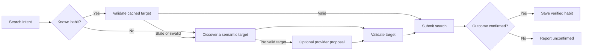
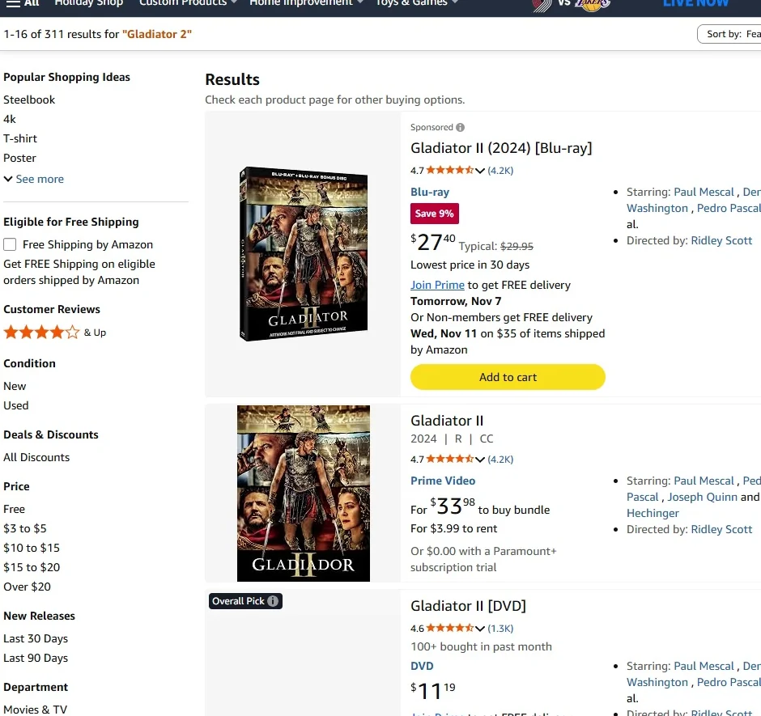

<div align="center">


# OMNISCIENCE

**Perceive. Remember. Act. Verify.**

*An experimental browser agent exploring adaptive procedural memory.*

[The idea](#the-research-question) · [How it works](#how-it-works) · [See the demo](#a-glimpse-of-the-demo) · [Run the checks](#setup-and-offline-checks)

</div>

---

Omniscience is an experimental browser agent and research project exploring how an AI system can **perceive an interface, remember successful procedures, and verify the results of its actions**. Its long-term aim is to make repeated digital tasks more reliable and adaptable by combining procedural memory with semantic understanding and carefully bounded model-assisted recovery.

## The research question

Can an agent learn a browser task, reuse a verified procedure on later attempts, and recover when an interface changes—while measuring task completion, latency, model use, and failure modes?

Omniscience explores a two-path approach:

- **Familiar tasks:** retrieve a previously verified, site-scoped habit and validate its target before using it.
- **Unfamiliar or changed interfaces:** discover targets through browser semantics and, where explicitly enabled, accept a proposal from a vision provider. Proposed actions still need validation and outcome confirmation.

The broader direction includes a persistent representation of interface objects and state, and experiments with predicting outcomes before actions. These are research goals, not capabilities demonstrated by the current code. Omniscience does not claim human-like understanding or a proven advantage over other agents.


## How it works



This diagram describes the current search path. Vision is an optional provider interface; proposals are validated using the same search checks. An unconfirmed submission is not retried automatically.

## A glimpse of the demo



*Historical demo footage: the original demo reached a results page for “Gladiator 2.” This is a single observed run of the legacy demo, not a benchmark or validation of the current verified workflow.*

## Current status

The repository is an early prototype. Its implemented verified workflow is limited to search: it discovers or retrieves a search field, checks that the target is actionable and unambiguous, submits the query, and checks for a narrowly defined URL outcome before saving a habit. It also preserves the original ambient-memory extraction, recall, and demonstration entry points. The legacy demo is independent of the verified search workflow; its displayed elapsed time is not a controlled benchmark.

The current vision interface is an opt-in extension point that accepts a caller-supplied provider; no vision model is bundled. The project does not yet provide general-purpose task planning, a persistent visual state graph, predictive simulation, or comprehensive safeguards for sensitive actions. Treat it as a research prototype, not an autonomous production agent.

## How we will evaluate it

Evaluation should compare familiar-task reuse, first-time discovery, and recovery under controlled interface changes using the same tasks and explicit completion criteria. Report successful completion and false positives alongside latency, model calls, cost when known, and failure cases. Use repeatable local fixtures first, then evaluate on held-out sites and realistic workflows. The existing checks are small fixture tests, not evidence of broad reliability or performance gains.

## Setup and offline checks

Python 3.11 and Playwright for Python are required for the live agent. Install `playwright` and its Chromium browser using the official Playwright instructions. `google-generativeai` is optional for the existing Gemini ambient extraction; without it the heuristic remains available. No dependency lock was provided upstream; versions have not been validated here.

Run the offline checks from the repository root:

```bash
python -m unittest discover -s tests -v
python tests/benchmark_offline.py
```

 On systems where the default temporary directory is unwritable, set `TEMP` and `TMP` to a writable directory. The unit tests use simulated pages. Run `python tests/browser_fixture.py` and `python tests/browser_regression.py` for intercepted local Chromium fixtures; they require an installed Playwright browser.

## Search and memory

For search only, cached selectors and semantic candidates follow the same unique, visible, enabled, editable, search-labelled target validation. Submission is confirmed only when navigation changes the URL and a decoded search parameter (or the search field name) equals the requested query on the same origin. This is deliberately narrow: single-page results, POST searches, identical-URL repeats, and other legitimate searches can report failure. It does not establish that relevant results loaded. A submitted but unconfirmed action is never automatically retried. The supplied domain must match the open page authority, including any explicit port. Successful verified selectors are stored per domain and intent in version 1 JSON. Legacy string entries are read in memory and migrated atomically on the next verified save; unknown versions and malformed JSON raise errors without overwriting the file. Back up memory before migration. Storage is single-process and has no concurrent-writer coordination.

Vision is disabled by default. To enable it, construct `UniversalUINavigator(vision_enabled=True, vision_provider=provider)`, where the provider accepts screenshot bytes and returns a CSS selector or None. The screenshot may contain sensitive information and the caller is responsible for the provider's data handling. The proposal is untrusted and passes the same semantic validation and outcome confirmation. Vision is called only when no semantic candidate can be validated, never after a submission. No provider is included; no claim of vision recovery effectiveness is made.

## Research baseline and limits

The upstream baseline at f9dc431 had no automated tests or benchmark, selected the first matching element, and treated a submitted click as success; it printed unmeasured performance claims. `tests/benchmark_offline.py` supplies reproducible mock scenarios and reports observed outcomes, not browser latency, real-world task completion, model spending, or a comparison against other agents. A proper study requires browser fixtures and held-out sites, repeated cold/warm trials, matched tasks, recorded model calls and costs, and independent outcome labels. Do not interpret mock results as proof of production reliability or research novelty.

## Browser comparison

Run `python tests/compare_baseline.py` from a Git checkout containing upstream commit `f9dc431`. It compares one trial per scenario in an intercepted Chromium fixture. On the development machine, both versions reported success for a unique search; the upstream version also reported success for ambiguous fields and a form that did not navigate, while the current version refused both. This is a small deterministic behavior check, not a completion-rate or performance study.
